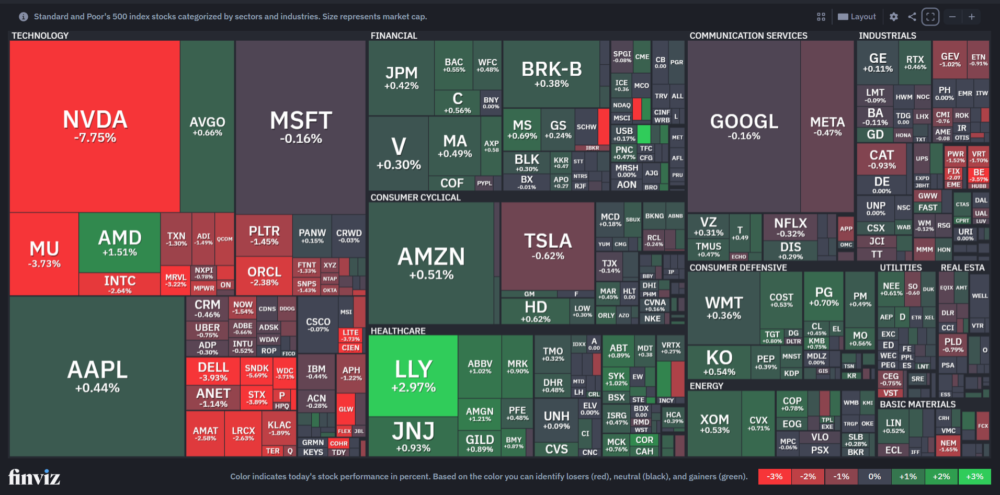

# Planning Document

## About
This project aims to create the heatmap from Finviz.com

## Tech Stack
A web project that will use the following:

Frontend:
- HTML
- CSS
    - Bootstrap

Backend:
- JS

### Map Tech Stack
The map will be a HTML canvas object.

The grid will be rendered onto the canvas via JS

## Implementation Features

<h3 style="color: green">Willing To Do</h3>
These features are core to the project

---
**Multiple indexes:**
- Getting API data for multiple index funds, e.g. S&P500, Nasdaq100, FTSE100
---
**Multi-horizon performance:**
- A dropdown to select percentages for performance across multiple time horizons: [1 day, 1 week, 1 month, 1 year]
---
**Separation of industries:**
- Organising stocks into industries
- Getting the market cap allocations of the industries. This will make blocks of industries proportional
---
**Colours:**
- Units are coloured based on performance colour map
- Example (daily): -3% (Bright red), -2% (Red), -1% (Light red), 0% (Grey), +1% (Light green), +2% (Green), +3% (Bright green)
- Example (annualy): -30% (Bright red), -20% (Red), -10% (Light red), 0% (Grey), +10% (Light green), +20% (Green), +30% (Bright green)
---
**Responsiveness:**
- Canvas can change responsively, which would dynamically update calculations for the grid
---
**Dynamic Text Visibility:**
- For large-cap stocks, the ticker and percentage are visible on its unit
- For smaller-cap grid units, ticker, percentage, or both will have to be hidden
---

<h3 style="color: yellow">Unsure To Do</h3>
These features have less priority and may get implemented depending on difficulty

---
**Search:**
- Being able to locate a company within the grid
---
**Zoom/Pan:**
- Control panel to zoom in, zoom out, reset zoom
- After zooming in, user is able to pan around
<h3 style="color: red">Not To Do</h3>
These features will not be necessary to implement

---
**Alternative maps:**
- Bubble
- Matrix
---
**Interactivity:**
- Hover effects
- Clicking on individual stocks to get a sumamary of the company
---
**Real time updates:**
- When market is open, frequently call API to fetch latest percentages 

